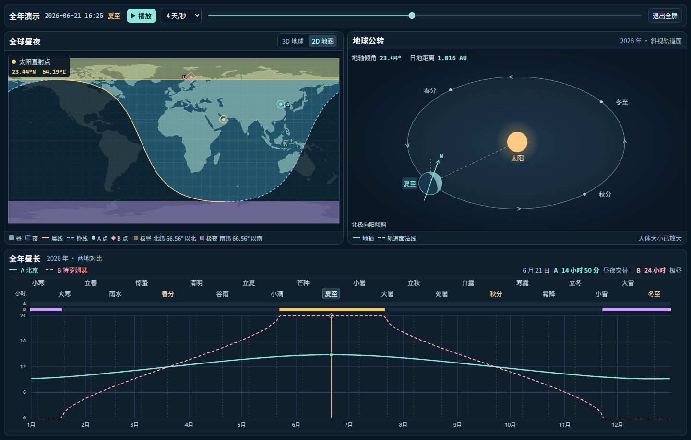
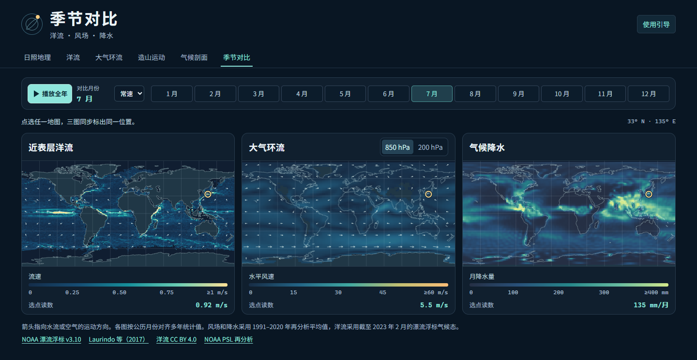
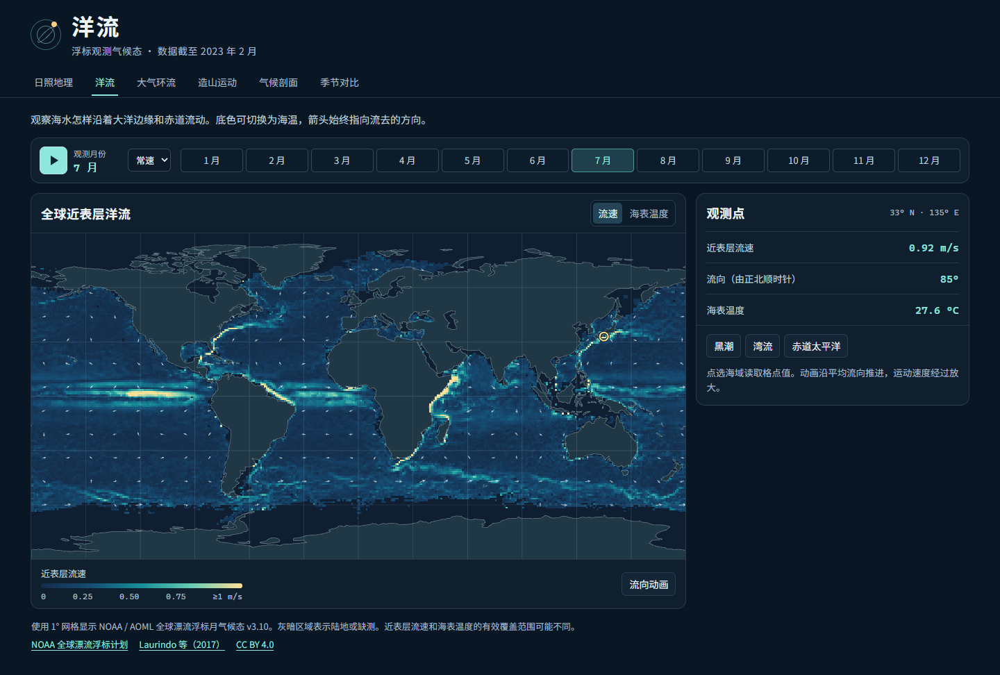
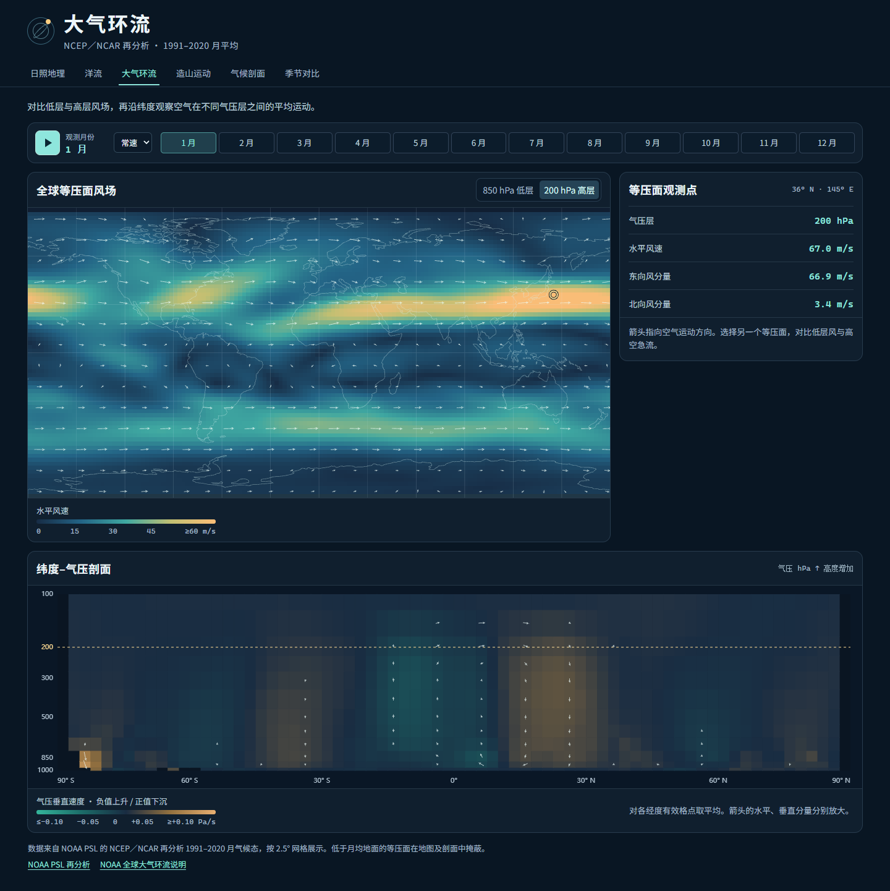
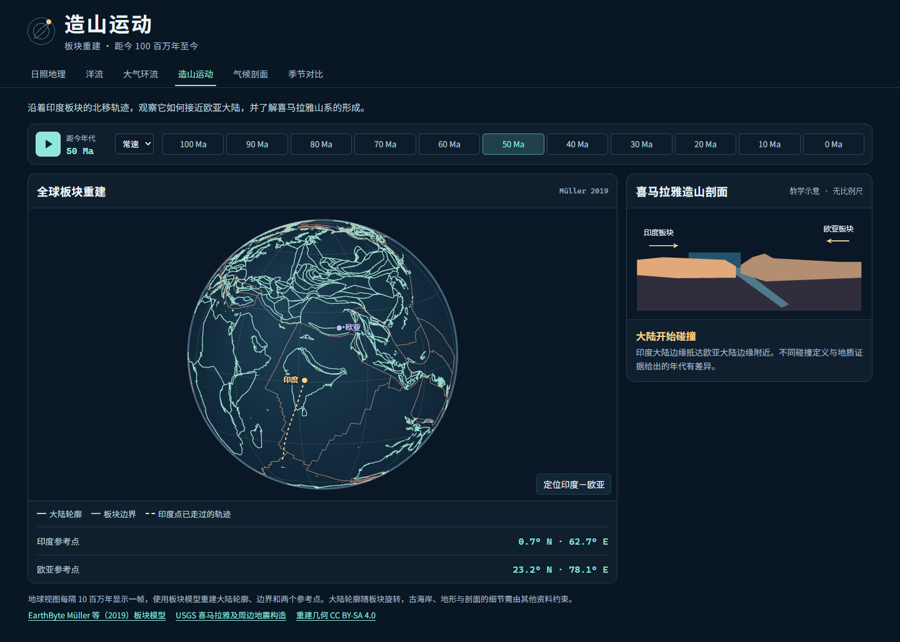
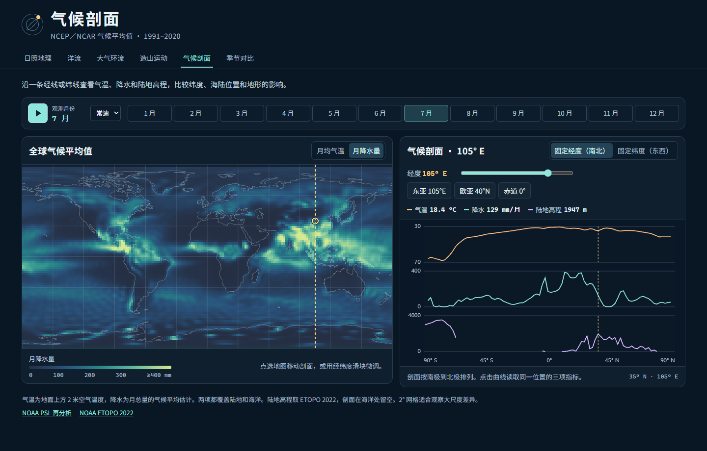

# 自然地理可视化

用交互地图、地球和剖面探索日照、洋流、大气环流、造山运动与气候。通过节气、月份或地质年代切换视图，观察同一现象的变化，也可以在「季节对比」中同时查看洋流、风场和降水。

[快速开始](#快速开始) · [功能与截图](#功能与截图) · [数据来源与口径](#数据来源与口径) · [开发与部署](#开发与部署)

## 快速开始

准备 Node.js 22.12 或更新版本。在项目根目录运行以下命令。

~~~sh
npm ci
npm run dev
~~~

打开终端显示的地址，默认进入「日照地理」，观测时刻为北京时间 2026 年 6 月 21 日 12:00。首次访问会弹出八步引导，可直接探索，也可从页首「使用引导」重看。季节对比页有独立的四步引导。

用页首导航切换专题，也可以在站点地址后加 `#ocean`、`#atmosphere`、`#mountains`、`#climate` 或 `#compare` 直达。应用随构建分发地图和专题数据，可在静态 HTTP 服务上运行。

## 功能与截图

以下截图均来自本地生产构建，按各节说明可复现相应画面。

### 日照地理与全年演示

- **观察日照。** 在 2D 地图或可旋转的 3D 地球上选点，也可以用地点预设。拖动时间轴观察晨昏线、太阳直射点和太阳高度角。切换夏至与冬至可对照两极金色的极昼范围和紫色的极夜范围。
- **比较两地。** 点击「添加对比地点」选 B 点，再打开「全年曲线」。两条曲线按两地各自的当地月日对齐，标出二十四节气和极昼、极夜日期。点击曲线日期跳到 A 点的太阳上中天，点击节气跳到实际交节时刻。地图和当日读数共享同一观测时刻，各地点按自己的时区显示当地时间。
- **查看图中画面。** 在北京选择「2D 地图」和「夏至」，再点「全屏演示」。未添加 B 点时，演示会临时加入高纬度地点。顶部可以拖动日期、播放或以 1、4、12、24 天/秒调速，播放到 12 月 31 日暂停。

### 季节对比

从页首打开「季节对比」（`#compare`），在 1 月和 7 月间切换，观察三张地图如何一起变化。点任一地图，三图会标出同一坐标并各自给出读数。风场可切换 850／200 hPa。点击「播放全年」可从所选月逐月推进、暂停或调速，到 12 月自动暂停，再次播放从 1 月开始。

### 洋流

打开「洋流」（`#ocean`），选 7 月并点击「黑潮」。底色可切换为流速或海表温度，箭头指向水流方向，也可打开流向动画。右侧给出观测点的流速、方向和海温，并提供湾流与赤道太平洋预设。

### 大气环流

打开「大气环流」（`#atmosphere`），在 1 月切换到「200 hPa 高层」。地图着色表示水平风速，箭头指向空气运动方向。下方的纬度–气压剖面用虚线标出所选气压层，气压垂直速度为负表示上升、为正表示下沉。切回 850 hPa 可对照低层风。

### 造山运动

打开「造山运动」（`#mountains`），切到 50 Ma，再点「定位印度－欧亚」。拖动地球可观察重建后的大陆轮廓、板块边界和印度参考点的北移轨迹。时间轴从距今 100 百万年到现在，每 10 百万年一帧。右侧的喜马拉雅剖面是无比例尺的教学示意。

### 气候剖面

打开「气候剖面」（`#climate`），选择 7 月、「东亚 105°E」及「月降水量」。地图上的虚线标出经线，剖面同时显示月均气温、月降水量和陆地高程。点地图可移动剖面，点曲线可更新地图选点。切换到「固定纬度（东西）」可沿同一纬度比较海陆之间的差异。

## 数据来源与口径

- **日照地理**用 Astronomy Engine 计算太阳位置和节气。太阳高度及昼长以太阳中心和几何地平线为基准。实际日出与日落还受折射、太阳视半径和地形影响。
- **洋流**使用 NOAA 全球漂流浮标 v3.10 的月气候态，观测数据截至 2023 年 2 月 28 日。
- **风场、气温和降水**使用 NOAA PSL 的 NCEP／NCAR 再分析 1991–2020 年月气候态，地形来自 ETOPO 2022。季节对比按公历月份对齐三个专题的多年统计值，各数据源保留自己的统计时段与网格。
- **造山运动**使用 GPlates 的 Müller 2019 板块重建。大陆轮廓随板块旋转复原，教学剖面用于解释碰撞及地壳增厚的过程。

各专题页底部列出了数据来源。[数据清单](public/data/manifest.json)记录版本、来源、许可或使用说明和 SHA-256 校验值。[技术设计](docs/technical-design.md)说明数据处理与科学口径。

## 开发与部署

### 测试与本地预览

~~~sh
npm test
npm run build
npm run test:browser
~~~

单元测试使用 Vitest。Playwright 浏览器测试使用 `dist/`，并自动在 `127.0.0.1:4199` 启动预览服务。Windows 会优先查找默认安装路径中的 Chrome。其他环境可用 `npx playwright install chromium` 安装 Chromium，也可以通过 `PLAYWRIGHT_CHROMIUM_EXECUTABLE` 指定浏览器路径。

手动检查生产构建时，运行 `npm run preview` 并打开终端显示的地址。部署时将 `dist/` 的完整内容发布到静态 HTTP 服务。部署在子目录时，通过带尾斜杠的目录 URL 打开站点，专题仍用 `#compare` 等片段定位。

### GitHub Pages

首次部署时，在仓库 **Settings → Pages → Build and deployment → Source** 选择 **GitHub Actions**。此后推送到 `main` 会自动运行 [部署工作流](.github/workflows/deploy-pages.yml)，安装依赖、执行单元测试、构建并发布 `dist/`。也可以在 **Actions → Deploy to GitHub Pages → Run workflow** 手动运行。部署成功后，在运行详情的 `github-pages` 环境或 **Settings → Pages** 打开站点。

### 重新生成专题数据

项目已包含运行所需的派生数据。需要更新数据时，在 Python 环境安装脚本依赖并运行生成命令。

~~~sh
python -m pip install numpy scipy netCDF4 requests shapely
python scripts/prepare_topics.py
~~~

只更新某个专题时，可运行 `python scripts/prepare_topics.py climate`，或将 `climate` 换成 `ocean`、`atmosphere`、`mountains`。原始输入默认缓存到系统临时目录。需要重新下载时，用 `--cache` 指定一个新的缓存目录。脚本写入 `public/data/` 并更新清单，重新构建后即可预览新数据。
